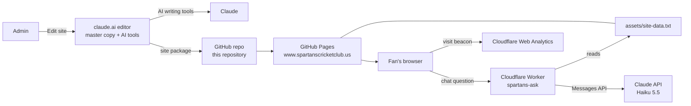

# Spartans Cricket Club – Official Website

Live site: **https://www.spartanscricketclub.us**

Official website of Spartans Cricket Club, Eastvale, California: five-time champions of the East Vale Premier League (Sands Cricket Association), with a title hat-trick in EPL – Div 1 (1.0) [2024–25], EPL – Div 1 (2.0) [2025] and EPL – Div 1 (3.0) [2025–26].

This repository holds the **public, static copy** of the site, served by GitHub Pages. The editable master copy lives on claude.ai (see [Architecture](#architecture)).

---

## Contents

- [Architecture](#architecture)
- [Repository contents](#repository-contents)
- [Front end](#front-end)
- [Data model](#data-model)
- [AI features](#ai-features)
- [Ask the Spartans chat (Cloudflare Worker)](#ask-the-spartans-chat-cloudflare-worker)
- [Hosting, domain and DNS](#hosting-domain-and-dns)
- [Search, sharing and analytics](#search-sharing-and-analytics)
- [Updating the site](#updating-the-site)
- [Operations and troubleshooting](#operations-and-troubleshooting)
- [Known limitations and roadmap](#known-limitations-and-roadmap)

---

## Architecture

| Layer | Technology | Role |
|---|---|---|
| Master copy | claude.ai published page | Editing, admin panel, AI tools, self-publishing |
| Public site | GitHub Pages (this repo) | Static snapshot served to fans |
| Domain and DNS | Cloudflare (registrar + DNS only) | `spartanscricketclub.us` and `www` point to GitHub Pages |
| Chat backend | Cloudflare Worker | Holds the Claude API key, calls Claude for public chat |
| AI | Claude (claude.ai and Claude API) | Scorecard reading, write-ups, chat |
| Analytics | Cloudflare Web Analytics | Cookie-free visitor stats |

**Update flow:** changes are made on the claude.ai master copy, a site package is generated from it, and the package is uploaded to this repository. GitHub Pages republishes within 1–2 minutes.

---

## Repository contents

| Path | Purpose |
|---|---|
| `index.html` | The entire website: markup, styles, scripts and embedded data (single file, about 0.5 MB) |
| `assets/` | Photos, videos, logos, crest icons and the link preview image |
| `assets/site-data.txt` | Plain-text summary of club data that the public chat answers from |
| `assets/og-image.jpg` | 1200 × 630 link preview image for WhatsApp and social media |
| `assets/icon-*.png` | Favicons and home-screen icons |
| `CNAME` | Custom domain (`www.spartanscricketclub.us`). **Do not delete.** |
| `robots.txt`, `sitemap.xml` | Search engine crawling and indexing |
| `ads.txt` | Authorises Google AdSense to sell ad space on the site |
| `README.md` | This document |

No build step, framework or package manager is used. Everything is plain HTML, CSS and JavaScript.

---

## Front end

- **Single-page app with hash routing.** Tabs are sections of one page (`#home`, `#news`, `#tv`, `#team`, `#fixtures`, `#archive`, `#gallery`, `#club`, `#sponsors`, `#about`, `#contact`). Switching tabs never reloads the page.
- **Styling.** CSS custom properties for colours (navy, gold, silver), with light and dark themes that follow the visitor's device. Fonts: Saira Condensed and Barlow (Google Fonts).
- **Main components:**
  - home slider (photos and video), rotating headline, countdown to the next match
  - honours band and analyst corner
  - fixtures and results with badges, score lines and CricClubs links
  - season archive with records, finals, highlights and full results
  - RCB-style squad grid with captain markers and player popups
  - Spartans TV (videos and photos in a full-screen viewer)
  - Gallery (on-field photos) and Club life (off-field photos), both with album filters
  - sponsors, About us and the Ask the Spartans chat panel
- **Accessibility.** Semantic headings, labelled controls, keyboard focus styles, reduced-motion support.

---

## Data model

**Fixed data in the code** (changes only when the site code is edited):

- `players`: name, role, captain flag and display name (the display name keeps two players called Vivek Desai apart)
- `fixtures`: current season schedule (EPL Div. 1 4.0 2026)
- `ARCHIVE`: past seasons, each with name, CricClubs series, months, honour and every match (stage, date, teams, result, score)
- `SPONSORS`, `SLIDES`, `VIDEOS`, `CLUB`, `photos`: media and partner content

**Editable data stored in the page** (`<script id="state">`, changed through Edit site on claude.ai):

| Field | Holds |
|---|---|
| `results` | Result (W/L/T/NR) and score line per match |
| `cards` | Spartans batting (runs, balls) and bowling (overs, runs, wickets) per match |
| `bf` | Whether Spartans batted first or chased |
| `links` | CricClubs scorecard link per match |
| `news` | Match reports and posts, with dates |
| `ai`, `prev`, `spot` | Claude-written season analysis, match previews and player spotlights |

**Calculated in the browser (no AI):** season record, win rate, batting-first vs chasing records, form guide, leaderboards, in-form batters, economy, player stats and archive highlights. Every number comes straight from the scorecards and results.

---

## AI features

| Feature | Where | How it works |
|---|---|---|
| Scorecard reader | claude.ai (Edit site) | Reads a saved CricClubs page, pasted text or screenshots, extracts the result and Spartans batting and bowling, and matches names to the squad. The admin reviews an editable table before saving. |
| Match report writer | claude.ai | Writes a headline and 2–3 sentences using only that match's figures |
| AI insights | claude.ai | Season analysis, match previews and player spotlights from the site's own data |
| Ask the Spartans | claude.ai and public site | Answers fan questions using only the site's data |

**Grounding.** Every AI feature receives an exact summary of the site's data (fixtures, results, scorecards, squad stats, archive, honours, sponsors) and is instructed to use only that data and to say when something isn't on the site.

---

## Ask the Spartans chat (Cloudflare Worker)

On the public site the chat button calls a Cloudflare Worker, which calls the Claude API.

- **Endpoint:** set in `index.html` as `window.ASK_ENDPOINT` (currently the Worker's `workers.dev` address; `ask.spartanscricketclub.us` is also connected).
- **Model:** Claude Haiku 5.5 (`claude-haiku-5-5`), set in the Worker code.
- **Grounding data:** the Worker reads `assets/site-data.txt` from this site (cached for 5 minutes) and adds today's date.
- **Request format:** `POST` with JSON `{ "messages": [ { "role": "user", "content": "..." } ] }`, answered with `{ "text": "..." }`.

**Security and cost controls**

- The Claude API key is stored only as the Worker secret `ANTHROPIC_API_KEY`. It is never in this repository.
- Requests are accepted only from the site's own addresses.
- Each visitor can ask 20 questions per hour.
- Questions are capped at 500 characters and answers at 300 tokens.
- The site data is sent as a cached prompt prefix to lower cost.
- A monthly spending limit in Claude Console is the final safety net.

**Approximate cost:** about 3,500 tokens in and 100 tokens out per question, a small fraction of a cent each. A club site typically spends cents to a few dollars a month.

On claude.ai the same chat runs through the visitor's own Claude account instead of the Worker.

---

## Hosting, domain and DNS

- **GitHub Pages** serves the `main` branch root with the custom domain from `CNAME`. HTTPS is enforced.
- **Cloudflare DNS** for `spartanscricketclub.us` (all **DNS only**, grey cloud):

| Type | Name | Value |
|---|---|---|
| A | @ | 185.199.108.153 |
| A | @ | 185.199.109.153 |
| A | @ | 185.199.110.153 |
| A | @ | 185.199.111.153 |
| CNAME | www | harsha-egen.github.io |
| TXT | _github-pages-challenge-harsha-egen | GitHub domain verification |

- The Worker runs separately on Cloudflare (`spartans-ask`) and does not affect the GitHub records.

---

## Search, sharing and analytics

- **Search:** official title, meta description, canonical URL, structured data (`SportsTeam` with home ground Harada Heritage Park and links to Instagram and CricClubs), `sitemap.xml` and `robots.txt`. The domain is registered in Google Search Console.
- **Sharing:** Open Graph and Twitter card tags with `assets/og-image.jpg`.
- **Analytics:** Cloudflare Web Analytics (no cookies), loaded with the token in `window.CF_WA_TOKEN`.
- **Advertising:** Google AdSense (publisher `ca-pub-3388397184176516`). The AdSense script is in the `<head>` of `index.html`, `ads.txt` authorises Google as the seller, and the Privacy policy page (`#privacy`) carries the required advertising-cookie disclosures.

---

## Updating the site

1. Make changes on the claude.ai master copy (Edit site: scorecards, results, news, AI insights) or ask Claude.
2. Ask Claude for a fresh site package. Each package regenerates `assets/site-data.txt` and keeps the analytics token, CNAME and SEO settings.
3. Unzip it, then in this repository choose **Add file > Upload files**, drag in everything and **Commit changes**.
4. The site updates in 1–2 minutes; the chat picks up new data within about 5 minutes.

**Adding an archive season:** export the season's results CSV from CricClubs (or save its scorecard pages) and give it to Claude to add as a new `ARCHIVE` entry.

---

## Operations and troubleshooting

| Symptom | Check |
|---|---|
| Changes not visible | Hard refresh (Cmd/Ctrl + Shift + R); allow up to 10 minutes for GitHub's cache |
| Domain not working | Repository **Settings > Pages** shows "DNS check successful" and HTTPS enforced; `CNAME` file present |
| Chat says "Sorry, I couldn't answer that just now." | Worker secret name is exactly `ANTHROPIC_API_KEY`; see the Worker's **Logs / Observability** tab |
| Chat says "Too many questions right now" | Visitor hourly limit, or the Claude Console spending limit was reached |
| Chat button missing | `window.ASK_ENDPOINT` set in `index.html`; Worker's production URL enabled |
| No analytics data | `window.CF_WA_TOKEN` set in `index.html`; visits appear within an hour |

---

## Known limitations and roadmap

- The public site is a static snapshot; updates need a package upload (could be automated with a GitHub Action).
- One URL for the whole site; individual player and season pages would help search ranking.
- The per-visitor chat limit is approximate (counted per Cloudflare location); the Claude spending limit is the hard stop.
- "Matches played" counts only players who batted or bowled.
- The fan poll and Join the squad form are display-only on the public site; storing votes and enquiries would need a small backend (for example Cloudflare D1 or a form service).
- Archive seasons currently include results only (no per-player figures).

**Ideas:** sponsorship tiers and media kit, supporter memberships, merchandise store link, league table, live match-day updates, newsletter signup, calendar subscription, more archive seasons (EPL – Div 1 (1.0) [2024–25], 2022 titles).
